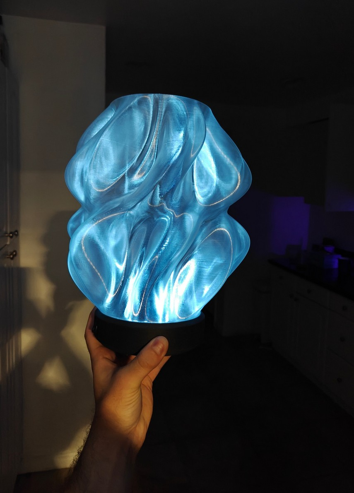
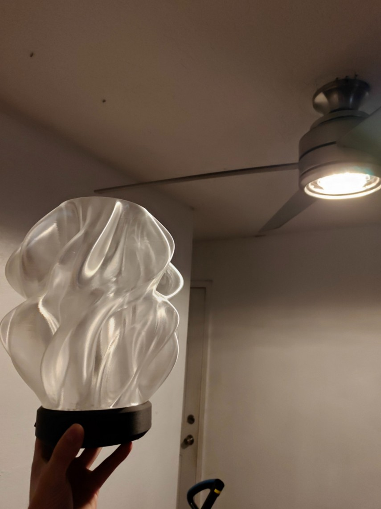
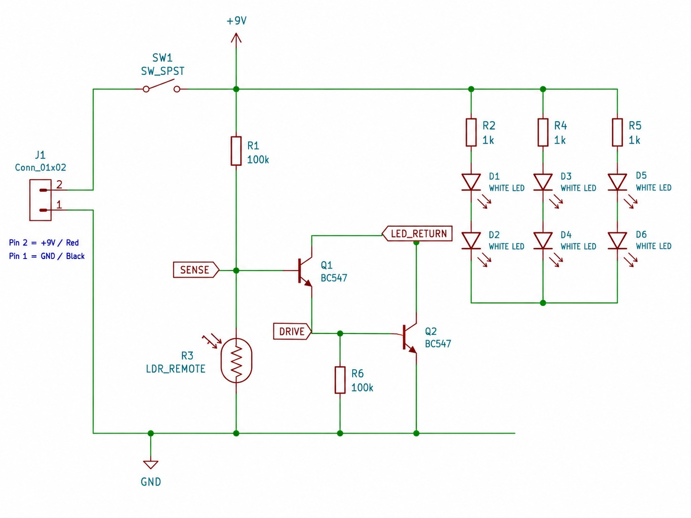
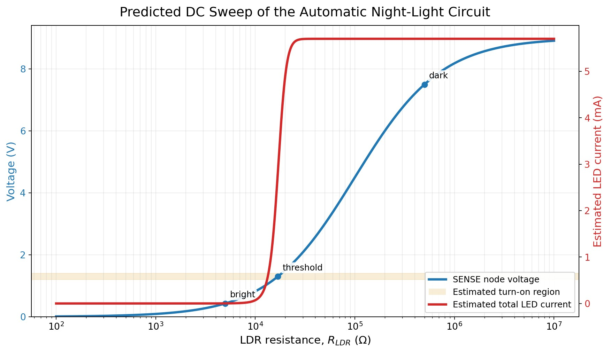
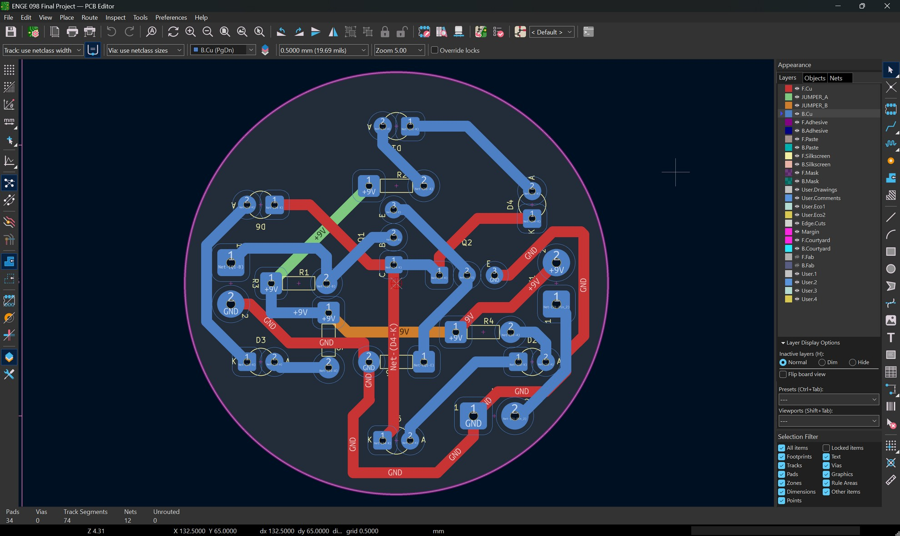
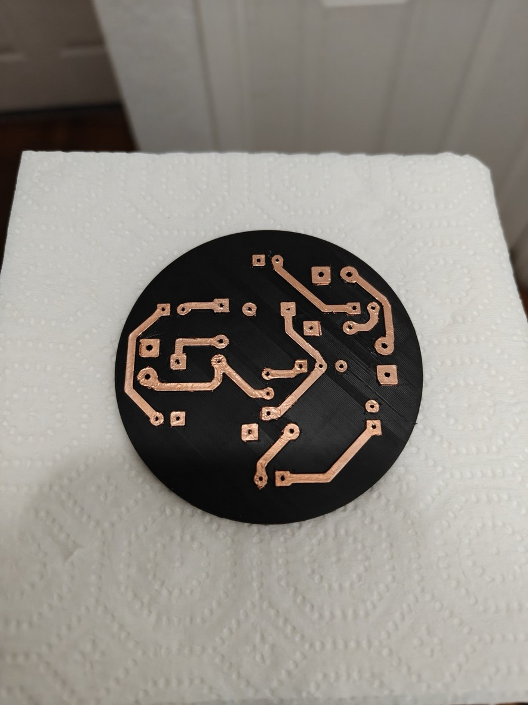
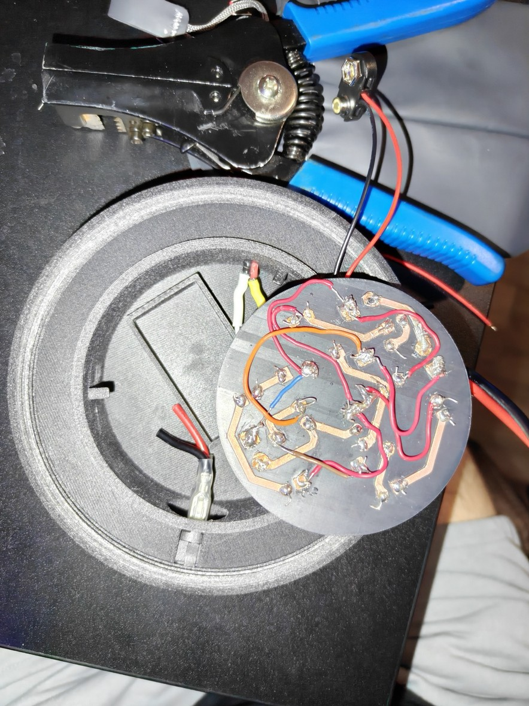
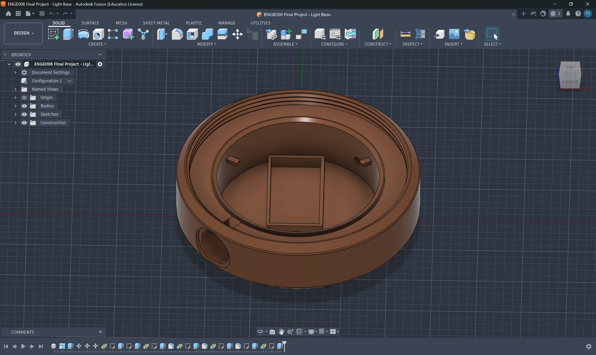

# Light-Activated Nightlight | Custom 3D-Printed PCB

**ENGR 098 — Circuit Analysis | Summer 2026**  
**Tools:** KiCad, Fusion 360, Cadence PSpice, 3D printing, hand circuit analysis  
**Status:** Built and tested; identified an intermittent sensor-connection fault

## At a Glance

Designed, analyzed, and fabricated a **9 V automatic nightlight** using a light-dependent resistor (LDR), two BC547 NPN transistors, and six white LEDs. Rather than using a conventional manufactured PCB, I created a **custom 3D-printed circuit substrate** with adhesive copper-foil traces and short insulated jumpers. The work included schematic design, mathematical analysis, PCB layout, breadboard verification, physical assembly, and troubleshooting.

| Dark — LEDs on | Bright — LEDs off |
| :---: | :---: |
|  |  |

*Photographs from the completed project report. The finished circuit responds correctly when the photoresistor connection is secure; the connection was intermittently unreliable, as documented below.*

## Circuit Architecture

The circuit has three functional blocks:

1. **Light sensing:** A GL5516-type photoresistor and 100 kΩ resistor form a divider. The divider output (SENSE) increases as the environment gets darker.
2. **Switching:** Two BC547 NPN transistors form a discrete Darlington-style low-side switch. This reduces loading of the relatively high-resistance sensing network, at the cost of a higher turn-on voltage and on-state drop.
3. **LED output:** Six white LEDs are arranged in **three parallel branches**, each consisting of **two series LEDs and a separate 1 kΩ current-limiting resistor**.

A second 100 kΩ resistor provides a defined interstage pull-down path.

## Electrical Analysis

I used voltage-divider analysis, Thévenin equivalents, Kirchhoff's voltage/current laws, power checks, and transistor switching approximations to evaluate the design.

- **Light threshold:** Using an approximate 1.2–1.4 V two-junction turn-on region, the first-order calculated LDR transition range is **15.38–18.42 kΩ**.
- **Branch current:** With an assumed transistor-stage voltage drop, the estimated on-state LED current is **1.6–2.2 mA per branch**, or **4.8–6.6 mA total**.
- **PSpice:** Configured and ran a DC sweep of LDR resistance from **100 Ω to 10 MΩ**. The legacy evaluation environment did not provide an exported numerical trace; therefore, the values above are **analytical estimates, not measured or extracted simulation results**.

See the [full circuit-analysis report](docs/technical_report.pdf) for derivations, operating assumptions, fault models, and plots.

*Predicted response based on the circuit model and analytical assumptions; not a measured current trace or exported numerical PSpice result.*

## PCB Design and Fabrication

- Designed the PCB in **KiCad** using four custom footprint types for the 3D-print-oriented layout.
- Completed routing with **zero unrouted connections and zero KiCad DRC errors** before export.
- Printed the board using a **0.2 mm nozzle** to preserve small pads, holes, and raised trace details.
- Applied and trimmed **adhesive copper foil** along printed trace paths; added short insulated jumper wires for crossing connections.
- Integrated a roughly **78 mm** PCB into a modified lamp base with an approximately **90 mm** internal cavity.

| Copper foil before assembly | Rear wiring after assembly |
| :---: | :---: |
|  |  |

The enclosure was adapted in Fusion 360 from the externally sourced **[Waves Designer Lamp](https://www.printables.com/model/1261597-waves-designer-lamp/comments)** design. The source model is credited here; this repository does not redistribute its original design files.

## Testing, Results, and Troubleshooting

| Check | What happened |
| --- | --- |
| Breadboard functional test | LEDs turned **on in darkness** and **off in bright light**, as intended. |
| KiCad design rules | **Zero errors** and **zero unrouted connections** before fabrication. |
| Finished hardware, secure LDR contact | Demonstrated the intended dark-on / bright-off response. |
| Finished hardware, intermittent LDR contact | The light sometimes behaved as a **manual switch-only lamp**; automatic behavior worked approximately half the time. |
| Direct voltage/current measurements | **Not recorded**; a multimeter was not available. |
| Numerical PSpice output | Sweep setup ran, but numerical traces were not available in the exported legacy evaluation output. |

### Root-cause reasoning

The photoresistor leads were not sufficiently insulated or strain-relieved. When the LDR connection opened, the 100 kΩ pull-up drove the SENSE node toward 9 V, turning on the transistor stage even in bright light. This explains the observed intermittent, switch-only failure mode using the same divider equation developed during circuit analysis.

For a future revision, I would add mechanical retention/insulation at the LDR, improve solder-pad accessibility, and consider a comparator with hysteresis or an adjustable threshold. These are **proposed improvements**, not changes already implemented.

Additional details are recorded in the [test and troubleshooting log](docs/test_log.md).

## Repository Contents

| Folder | Contents |
| --- | --- |
| [`hardware/kicad/`](hardware/kicad/) | Editable KiCad schematic, PCB, project configuration, custom footprints |
| [`fabrication/`](fabrication/) | Bottom-copper trace DXF and plated/non-plated drill outputs |
| [`cad/`](cad/) | KiCad-exported STEP assembly model (not a native Fusion 360 file) |
| [`images/`](images/) | Figures and prototype photographs extracted from my original report |
| [`docs/technical_report.pdf`](docs/technical_report.pdf) | Detailed 16-page project report and analyses |
| [`docs/final_project_presentation.pptx`](docs/final_project_presentation.pptx) | Original project presentation |
| [`docs/design_notes.md`](docs/design_notes.md) | Technical design decisions and documentation scope |
| [`docs/test_log.md`](docs/test_log.md) | Observed results, known fault, and measurement limitations |

**To inspect or edit the design:** Open `hardware/kicad/ENGE 098 Final Project.kicad_pro` in a compatible KiCad installation; retain the included `fp-lib-table` and `Final Project Lib.pretty` directory. The original KiCad project filenames use *ENGE*, while the coursework documentation identifies the course as *ENGR 098*.

## Engineering Takeaways

- Connected theoretical **circuit analysis** to component selection, switching behavior, and current-limited LED loads.
- Created custom KiCad footprints and translated electrical routing into a **nontraditional PCB fabrication process**.
- Practiced troubleshooting by linking an actual intermittent hardware fault to an **open-LDR equivalent circuit**.
- Learned why mechanical strain relief, soldering technique, and measurement access matter as much as a correct schematic.

*This was an academic prototype, not a production-qualified PCB or a fully characterized device. Calculated values, modeling, and observed behavior are identified separately throughout the documentation.*
